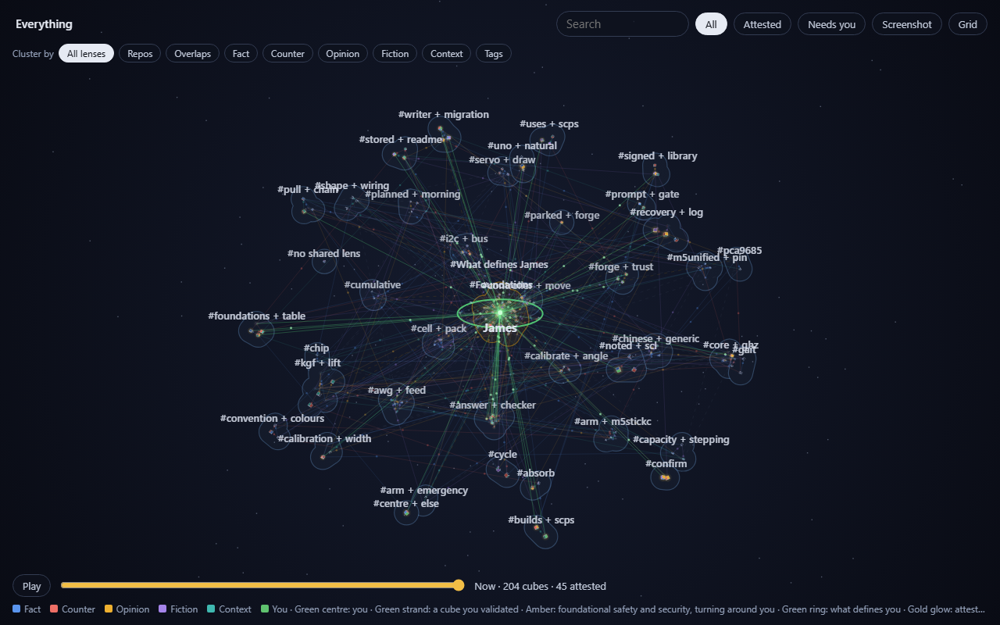
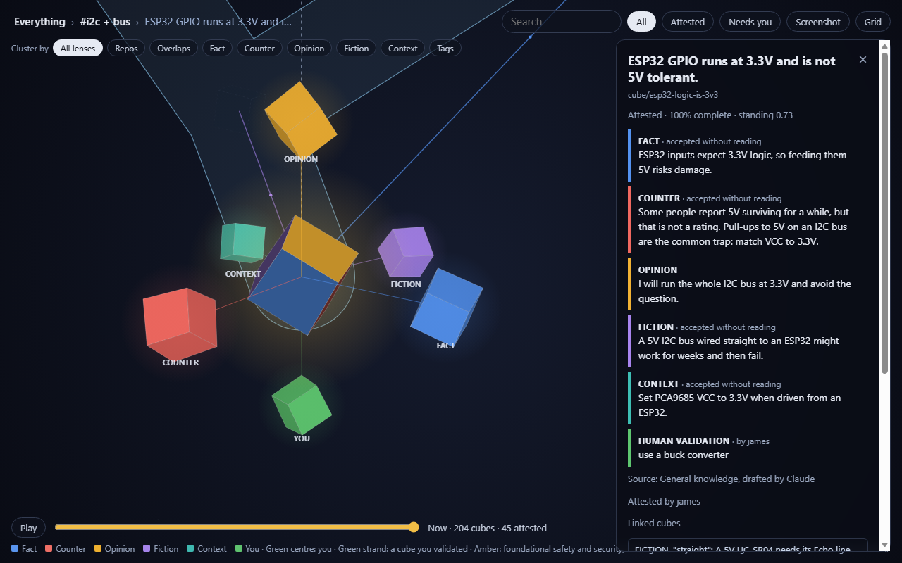
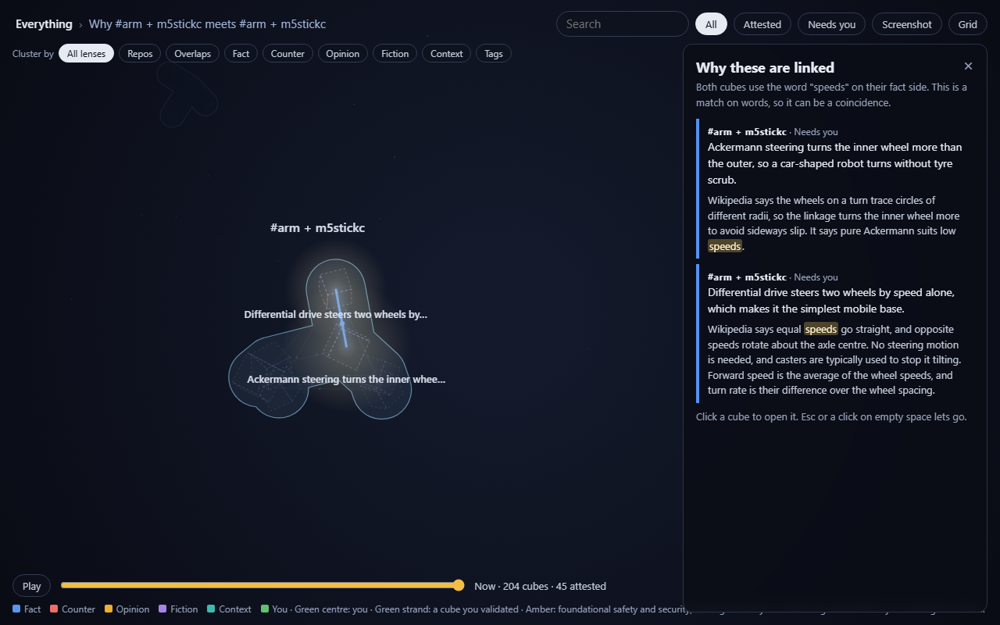
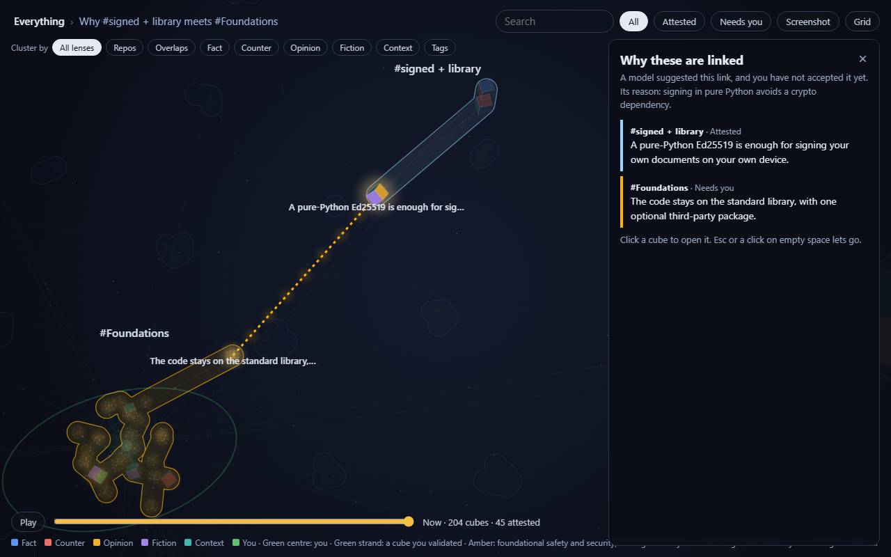
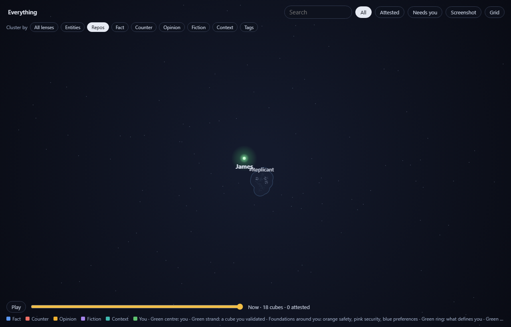
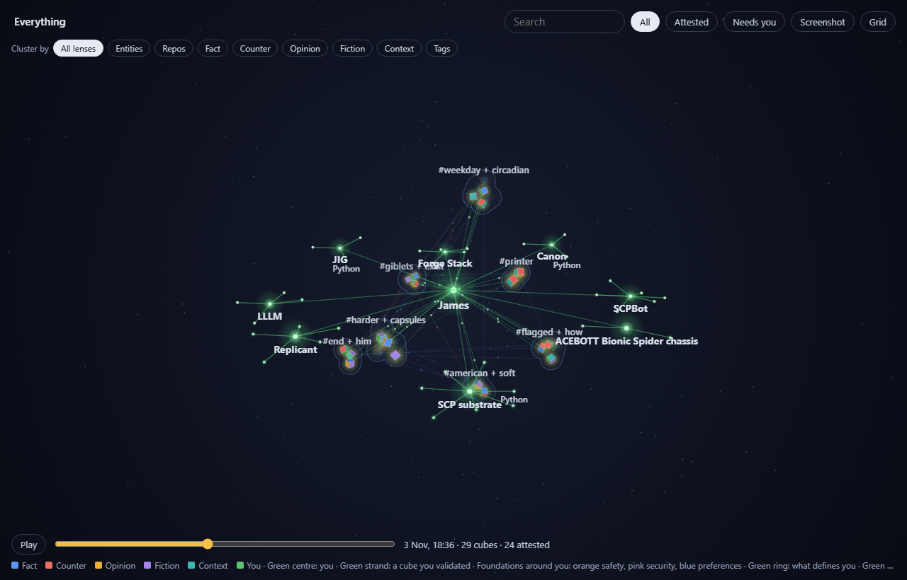
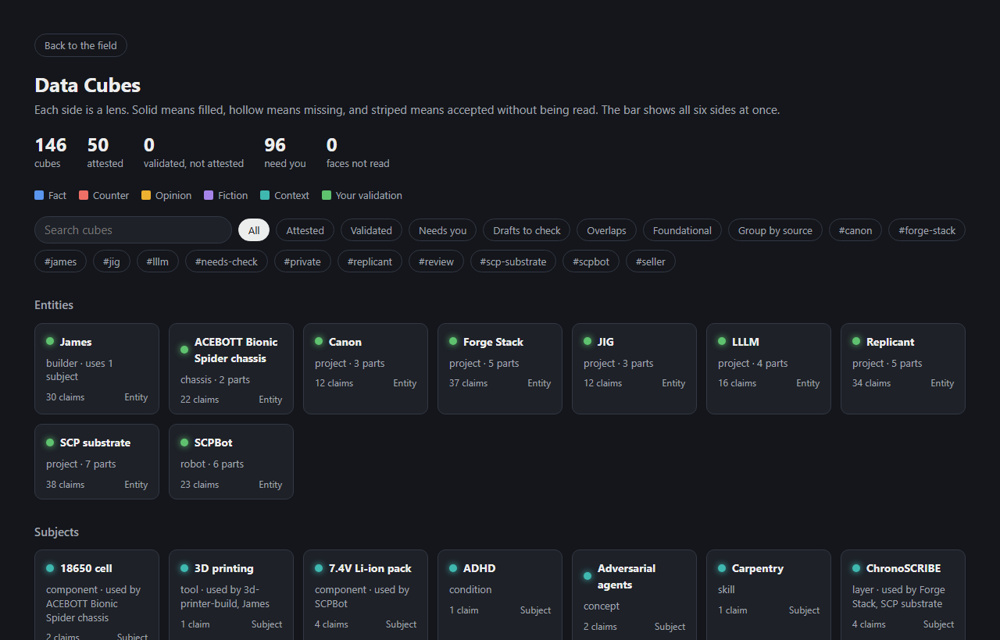
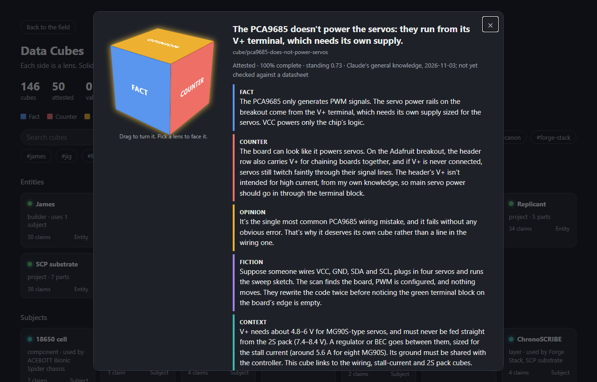
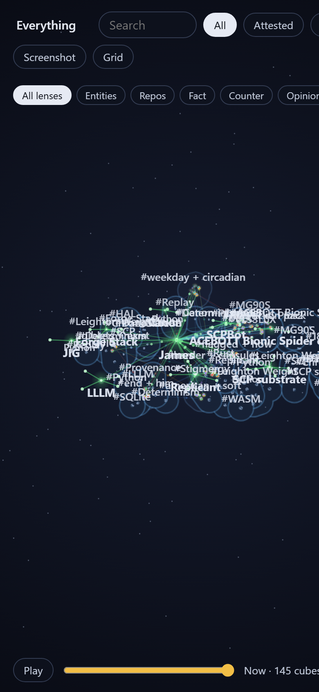
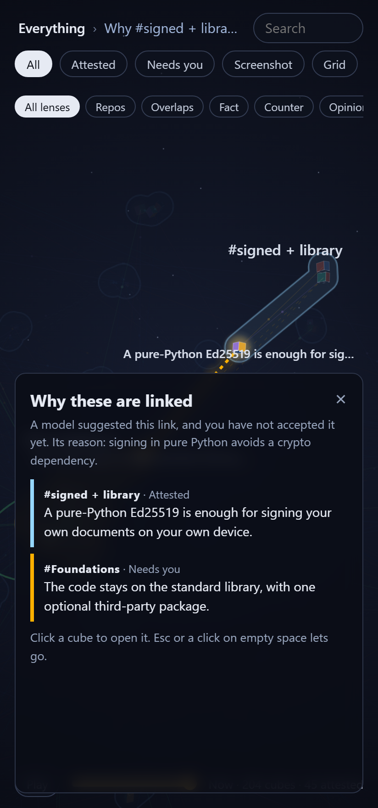

# SCP Substrate

A personal knowledge store in one SQLite file, with tools for querying it, tracking trust in claims, and examining claims as cubes. It is written in Python and needs no third-party packages, except for the optional Claude feature.

It is a single-user project and it is early. Read [Limits](#limits) and [Known issues](#known-issues) before relying on it.



## Parts

- **Substrate:** stores capsules (JSON records), links between them, and a log of events.
- **Engines:** derive links from rules, and compute trust scores.
- **SymLM:** a small rule-based language layer that answers questions by walking the graph. It uses no model weights.
- **Keystone Gate:** cubes, a gate that checks answers, an optional model layer, and a 3D page for browsing and editing cubes. See [keystone-gate/README.md](keystone-gate/README.md).

## How data is organised

Everything stored is a capsule, a link or an event. A capsule's type is its foundation.

The model being built on top of this, with entities, subjects, claims, evidence and relationships, is set out in [docs/VOCABULARY.md](docs/VOCABULARY.md). To start a new project from a written outline, see [docs/OUTLINE.md](docs/OUTLINE.md).

Foundations are defined in `sc.json`. Run `scripts/bootstrap.py` to copy them into `sc.db`; this does not happen automatically. Instances (people, projects, documents, repos, symbols, cubes, conversation turns) live only in `sc.db`.

`schema.sql` has changed once since the move to SQLite: the unused `rules` table was dropped, and that was logged as a `schema.migration` event. New kinds of data go in `state_json`.

## Getting started

To run the cube page and work through drafts, see [docs/STARTUP.md](docs/STARTUP.md).

Commands are shown for Windows. On Linux or macOS the same commands work, and `./scps` and `./keystone-gate/kg` can also be run directly.

```sh
python scripts/bootstrap.py        # copy sc.json into sc.db
python tests/run.py                # run all tests
python scps stats                  # what is stored
```

The command is `scps`, not `scp`, which is OpenSSH's secure copy.

## Asking questions

```sh
python scps ask "who is james"
python scps ask "what did I decide about sqlite"
python scps ask "what do I believe about signing"
python scps ask "what do I trust"
python scps ask "why is scp-claim trusted"
python scps ask "is james-gilbert-v1 signed"
python scps ask "list all repos"
python scps ask "where is parse_sentence"
python scps ask "what files in repo/scp-substrate"
```

`scps ask` is not checked by the gate. Use `python keystone-gate/kg ask "<question>"` for the gated version.

Questions are matched to intents by substring, so most phrasings that differ from the intent's phrases get no answer.

## Cubes

A cube is one claim examined through five lenses: FACT, COUNTER, OPINION, FICTION and CONTEXT. Each lens is worth 16% and human validation 20%. A complete cube can be attested, which means a person vouches for it. Attestation adds evidence to the cube's trust score.

To work on cubes in the browser:

```sh
python keystone-gate/kg cube password              # set the editing password, once
python keystone-gate/kg cube serve --by james      # edit in the grid view; Ctrl+C to stop
python keystone-gate/kg cube view                  # read-only snapshot, build/cubes.html
```

Press **Unlock to edit** in the grid view to change anything. The password protects the page only, not `sc.db` or the `kg` commands.

### What the page looks like

Click a cube to open it. Its five lenses and your validation float around it, and the panel shows each one in full.



Click a thread between two cubes to pull it. The two cubes come together, the rest fades, and the panel says why they are linked. For a word match, the shared word is marked in both sentences.



A dashed thread is a suggested link you have not accepted. The foundational cubes gather around you in three colours: orange for safety, pink for security and blue for preferences. This picture was taken before preferences were added, when all foundations were amber.



**Cluster by** regroups the cubes, here by the repo each one came from.



The bar at the bottom steps back through time. This is the store as it was on 2 November, with 88 cubes.



The grid lists every cube. The bar under each one shows its six sides, and a striped side was accepted without being read. Editing happens here, after you unlock it.





The page works on a phone through Tailscale. See [docs/STARTUP.md](docs/STARTUP.md).

<p>
  
  
</p>

These pictures come from the full local store. The public snapshot leaves out private cubes and drafts, so it shows less.

To review them at the terminal:

```sh
python keystone-gate/kg cube review --by james
```

## scps commands

```text
scps stats                     substrate counts
scps list [-f foundation] [-k kind]   list instances
scps observations              list observation capsules
scps trust <id>                parameter and evidence trust
scps fused <id>                prior and evidence combined
scps why <id>                  why a capsule is trusted
scps explain <id>              describe a capsule
scps verified <id>             verification records
scps version <id>              version chain through supersedes
scps ask "<question>"          natural language query, not gated
scps talk                      interactive prompt
scps parse "<sentence>"        grammar parse, prints the tree
scps generate [--seed N] [--start S|NP|VP|PP]   generate from the grammar
scps analyse-corpus [--only parseable|gaps|all] grammar gap analysis
```

These commands write to `sc.db`:

```text
scps rules                     runs the rule engine and adds any derived links
scps trust-compute             recomputes stored trust scores, resetting their decay
scps confirm <session>         marks a parse correct, trust up
scps reject <session>          marks a parse wrong, trust down
scps sweep-parse [--older-than-hours N]   deletes old parse sessions
scps forget-parse <session>    deletes one parse session
```

## Signing a document

```sh
python scripts/keygen.py default       # writes ~/.config/scp/keys/default.json
python scripts/sign_doc.py my-doc.scp.json -o my-doc.signed.scp.json
python scripts/import_scp.py my-doc.signed.scp.json
```

`import_scp.py` verifies the signature and writes a `verification:*` capsule. A signature shows who signed a document. It does not say the document is true.

`keygen.py` uses its first argument as the key name, and keeps the key unencrypted on disk.

## Indexing repositories

```sh
python scripts/absorb_repo.py /path/to/repo --dry-run
python scripts/absorb_repo.py /path/to/repo --write
python scripts/absorb_repo.py /path/to/repo --write --prune    # also deletes capsules for removed files

python scripts/absorb_github.py owner/repo --dry-run
python scripts/absorb_github.py owner/repo --write
```

Local indexing stores file hashes, line counts, imports and function and class names. GitHub indexing stores metadata and the file tree only. Neither stores file contents.

The index is a snapshot. Re-run `--write --prune` after files move, or `where is` answers will show old paths.

## Layout

| Path | Contents |
|---|---|
| `scps` | Main CLI |
| `sc.json`, `sc.db`, `schema.sql` | Foundations, data, schema |
| `src/` | Substrate, engines, crypto, SymLM, walkers |
| `scripts/` | Bootstrap, keys, importers, indexers, vocabulary tools |
| `seeds/` | Scripts that create starting capsules. Most are create-only, so capsules are authoritative after the first run |
| `tests/` | `run.py` runs every test file. `test_house_rules.py` checks the line limit on code and page files, and silent exception handlers |
| `keystone-gate/` | Cubes, gate, model layer, page and server |
| `docs/` | `SPEC.md`, `VOCABULARY.md`, `STRUCTURE.md`, `REASONING.md`, and signed SCP documents |
| `archive/` | Archived capsules, links and events, made by `scripts/archive_cubes.py` |

`docs/STRUCTURE.md` has the full file list.

## Limits

- **Network:** nothing runs as a hosted service. Two things reach the internet, only when you run them: `absorb_github.py`, and `kg ask --claude`, which sends your question and the walker's answer to Anthropic, then to Google if Claude fails. `kg cube serve` listens on 127.0.0.1 only.
- **Single user:** one SQLite file and one writer. Concurrent writers are not supported.
- **Language:** SymLM has 12 grammar rules and 478 words. It answers what its 13 intents cover and nothing else.
- **Search:** there is no content search. Use grep for that.
- **Conversation:** `scps talk` logs turns but does not read them back, so each session starts fresh.
- **Word features:** only 97 of the 478 words have animacy features. The rest pass semantic checks by default, so generated sentences can be odd.
- **Signing:** `ed25519.py` is pure Python and not constant-time. Use it for your own documents on your own device, not where an attacker can measure timing, and not for signing on behalf of others.
- **Canonicalisation:** a local convention, not RFC 8785. Other tools would need the same rules to verify a signature.
- **Importers:** `import_scp.py` handles giblets-scp v1.x only.
- **Trust scores:** there is one materialised score, evidence is scored by hand, and nothing has been checked against outcomes, so scores are not calibrated. Attestation adds a fixed amount, however good the reasoning behind it.
- **Lens clusters:** they measure shared words, not shared meaning. Some links are coincidences.

## Known issues

- `kg ask --claude` has not yet had a real answer from Claude. It has reached the API and got a credit error. Gemini and Ollama have answered live.
- `default-cube` rules `unknown_required` and `forward_only_lens_changes` are not enforced.
- `kg_router.py` only lists neighbours. There is no routing.
- Foundation schemas are descriptive. Nothing validates capsule state against them.

## Extending it

- **Foundation:** edit `sc.json` and run `bootstrap.py`. No schema change is needed.
- **Rule condition type:** add `_eval_X()` to `rules.py`, a branch in `evaluate_rules()`, and a rule capsule.
- **Question type:** add a walker to `WALKERS` in `walkers.py` and an intent capsule. A new query goes in `queries.py`.
- **CLI command:** add `cmd_X()` and a subparser in `scps`.
- **SCP field:** read it with `json_extract(state_json, '$.path.to.field')`.
- **Word:** use `Substrate.write()` with `kind: lexical-entry`.
